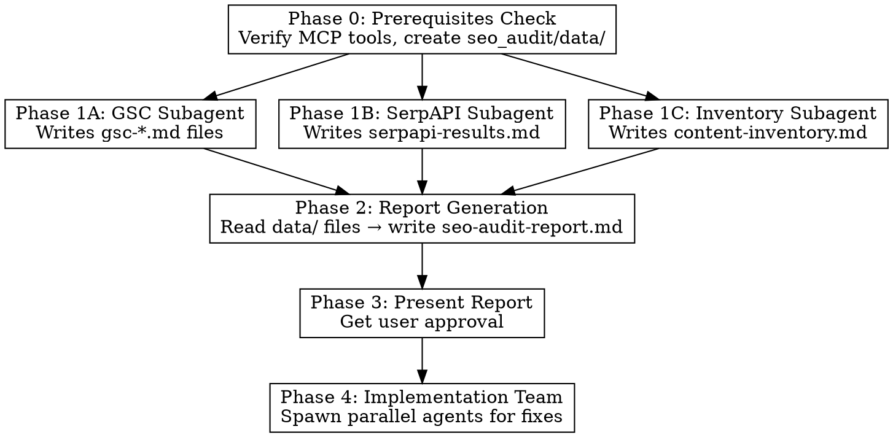
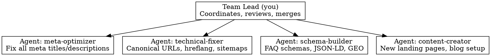

<!-- Claude Code skill · vincentrandon/claude-seo-audit-skill · SKILL.md · MIT
     Source: https://github.com/vincentrandon/claude-seo-audit-skill/blob/HEAD/SKILL.md
     Detected by: declared · Regenerated on every run; edit the upstream skill, not this copy. -->

# SEO Audit & Content Strategy

Full-stack SEO audit workflow producing a comprehensive report and spawning an implementation team. Uses MCP tools (SerpAPI, GSC) and codebase analysis.

## CONTEXT MANAGEMENT (CRITICAL)

This audit generates large volumes of data. To avoid hitting context limits:

1. **Each data collection phase runs in a dedicated subagent** (Task tool) that writes results to files in `seo_audit/data/`
2. **The lead agent (you) NEVER runs MCP queries directly** — always delegate to subagents
3. **Between phases, only read summaries** — never load raw data into the main context
4. **Write to disk immediately** — subagents must write files, not return large results in messages

```
seo_audit/
├── data/
│   ├── gsc-pages.md          ← Subagent writes GSC top pages
│   ├── gsc-queries.md        ← Subagent writes GSC top queries
│   ├── gsc-quick-wins.md     ← Subagent writes quick wins
│   ├── serpapi-results.md     ← Subagent writes ALL keyword research
│   └── content-inventory.md   ← Subagent writes codebase inventory
└── seo-audit-report.md       ← Final report (assembled from data/ files)
```

---

## Prerequisites Check (MANDATORY FIRST STEP)

Before starting any audit, verify MCP tool availability using `ToolSearch`. Run ALL checks in parallel:

```
ToolSearch: "+serpapi search"     → mcp__serpapi__search
ToolSearch: "+gsc search"         → mcp__gsc__enhanced_search_analytics, mcp__gsc__detect_quick_wins
ToolSearch: "+chrome screenshot"  → mcp__chrome-devtools__take_screenshot (optional)
ToolSearch: "+analytics report"   → mcp__analytics-mcp__run_report (optional)
```

**Display this report to the user:**
```
SEO Audit — Tool Availability:
[ok] SerpAPI              — keyword research, competitor analysis
[ok] Google Search Console — search performance data, quick wins
[!!] Chrome DevTools       — NOT AVAILABLE (will read source code instead)
[!!] Google Analytics      — NOT AVAILABLE (will rely on GSC only)
```

**Enforcement rules:**

| Tool | If Available | If Missing |
|------|-------------|------------|
| **SerpAPI** | **MUST run 8-12 keyword queries.** This is NOT optional. | STOP. Tell user: "SerpAPI MCP not configured. Add it with `claude mcp add serpapi` to enable keyword research. Without it, the audit cannot produce a data-driven content strategy." |
| **GSC** | **MUST run all 3 GSC queries** (pages, queries, quick wins). | Warn user: "GSC MCP not configured. Cannot pull live ranking data. Provide a GSC export or add the MCP server." Continue with SerpAPI-only analysis. |
| **Chrome DevTools** | Use for visual crawl of key pages. | Read templates/source code instead. Inform user. |
| **Google Analytics** | Pull traffic and conversion data. | Rely on GSC impressions/clicks. Inform user. |

**If SerpAPI is available but you skip keyword research: THIS IS A SKILL VIOLATION.** SerpAPI research is the foundation of the entire content strategy. Never skip it.

---

## Workflow: Multi-Phase with Subagents



**Key rules:**
1. **Phase 1 subagents run in parallel** — each has its own context window
2. **Phase 2 reads from files** — the lead agent reads `seo_audit/data/*.md` to assemble the report
3. **Never keep raw MCP data in the lead context** — always delegate to subagents that write to disk
4. Analysis first (Phases 0-2), implementation second (Phase 4), only after user approval

---

## Phase 1A: GSC Data Collection (SUBAGENT)

**Spawn a Task subagent** (`subagent_type: "general-purpose"`, `mode: "bypassPermissions"`, `run_in_background: true`).

The subagent prompt MUST include:
- The site URL (e.g., `sc-domain:example.com`)
- Instructions to use `ToolSearch` to load GSC tools first
- Instructions to write results to the 3 files below

**The subagent runs ALL 3 GSC queries and writes results:**

**File `seo_audit/data/gsc-pages.md`** — Query: top pages by impressions (16 weeks, dimensions: page, rowLimit: 25000)

**File `seo_audit/data/gsc-queries.md`** — Query: top queries by impressions (16 weeks, dimensions: query, rowLimit: 25000)

**File `seo_audit/data/gsc-quick-wins.md`** — Query: detect_quick_wins (minImpressions: 10, pos 4-20, maxCtr: 3)

Each file should contain a markdown table with the relevant data, plus a **summary section at the top** (5-10 bullet points with key findings).

---

## Phase 1B: SerpAPI Keyword Research (SUBAGENT — MANDATORY)

**Spawn a Task subagent** (`subagent_type: "general-purpose"`, `mode: "bypassPermissions"`, `run_in_background: true`).

**CRITICAL: The subagent MUST run 8-12 SerpAPI queries. This is not optional.**

The subagent prompt MUST include:
- The business name, services, location, and target languages
- Instructions to use `ToolSearch` to load SerpAPI tools first
- The query strategy table below
- Instructions to write ALL results to `seo_audit/data/serpapi-results.md`

**Query strategy — the subagent runs ALL of these categories:**

| # | Category | Example Query | Why |
|---|----------|---------------|-----|
| 1-3 | **Core service keywords** (primary language) | "agence automatisation IA", "python automation agency" | What the business does |
| 4-5 | **Core service keywords** (secondary language) | Same queries in other language | Cross-language opportunity |
| 6-7 | **Competitor + service queries** | "[competitor name] alternative", "[service] agency [city]" | Who ranks, local competition |
| 8-10 | **Long-tail informational** | "how to automate [process]", "[tool A] vs [tool B]" | Blog content opportunities |
| 11-12 | **Local/geo queries** (if applicable) | "[service] [city]", "[service] [country]" | Local SEO signals |

**SerpAPI params:** `engine: "google"`, `mode: "compact"`, `gl`/`hl` for locale, `num: 20`.

**The subagent writes `seo_audit/data/serpapi-results.md` with this structure:**
```markdown
# SerpAPI Keyword Research Results

## Summary
- [5-10 key findings: top competitors, content gaps, opportunities]

## Queries Performed
| # | Query | gl | hl | Key Finding |
[one row per query]

## Competitor Landscape
| Competitor | Domain | Ranking For | Strengths |
[extracted from results]

## Content Opportunities
| Keyword Cluster | Language | Search Intent | Content Format | Priority |
[all opportunities]

## People Also Ask (FAQ Content)
- [all PAA questions found, grouped by topic]

## Related Searches
- [all related searches, grouped by theme]
```

**The subagent MUST run queries in parallel (multiple tool calls) for speed.**

---

## Phase 1C: Content Inventory (SUBAGENT)

**Spawn a Task subagent** (`subagent_type: "Explore"` or `"general-purpose"`, `run_in_background: true`).

The subagent reads the codebase and writes `seo_audit/data/content-inventory.md`:

1. **All public pages**: templates, H1s, meta tags, schema types, word count estimates
2. **Blog/content pages**: sitemap or DB for published articles
3. **Meta tag coverage**: custom vs default/generic meta titles and descriptions
4. **Schema coverage**: JSON-LD schemas (FAQPage, Service, Article, etc.)
5. **URL structure**: trailing slash consistency, canonical tags, hreflang tags
6. **Internal linking**: which pages link to which

---

## Phase 2: Report Generation (LEAD AGENT)

**Wait for all Phase 1 subagents to complete**, then read the data files:

```
Read: seo_audit/data/gsc-pages.md       (focus on Summary section)
Read: seo_audit/data/gsc-queries.md      (focus on Summary section)
Read: seo_audit/data/gsc-quick-wins.md   (focus on Summary section)
Read: seo_audit/data/serpapi-results.md   (focus on Summary + tables)
Read: seo_audit/data/content-inventory.md (full read)
```

**Assemble the final report at `seo_audit/seo-audit-report.md`.**

**IMPORTANT context management during report writing:**
- Read one data file at a time if context is tight
- Copy relevant tables directly from data files into the report
- Do NOT re-process or re-analyze raw data — trust subagent summaries

**This file is the primary deliverable of the audit. It MUST be created.**

### Report Structure

```markdown
# SEO Audit Report — [Website Name]
## [Date]

---

## 1. Executive Summary
- Current state: [X] pages, [Y] indexed, [Z] monthly impressions
- Critical issues found: [count]
- Quick wins identified: [count]
- New content opportunities: [count]

---

## 2. Google Search Console Analysis
### Top Pages by Impressions
| Page | Impressions | Clicks | Avg Position | CTR |
|------|------------|--------|-------------|-----|
[data rows]

### Top Queries
| Query | Impressions | Position | Language |
|-------|------------|----------|----------|
[data rows]

### Quick Wins (position 4-20, low CTR)
| Query | Impressions | Position | Opportunity |
|-------|------------|----------|-------------|
[data rows]

### Issues Detected
- [ ] Duplicate URLs (trailing slash inconsistency)
- [ ] Zero CTR on high-impression queries
- [ ] Pages with impressions but no clicks
[etc.]

---

## 3. Keyword Research (SerpAPI)
### Queries Performed
| # | Query | Language | Location | Key Finding |
|---|-------|----------|----------|-------------|
[8-12 rows with actual queries run]

### Competitor Landscape
| Competitor | Strengths | Ranking For |
|-----------|-----------|-------------|
[extracted from SerpAPI results]

### Content Opportunities
| Keyword Cluster | Language | Est. Volume | Current Ranking | Opportunity |
|----------------|----------|-------------|-----------------|-------------|
[all opportunities found]

---

## 4. Technical SEO Audit
### Meta Titles & Descriptions
| Page | Has Custom Meta | Title Length | Description Length | Issue |
|------|----------------|-------------|-------------------|-------|
[every public page]

### Canonical URLs
- Trailing slash consistency: [ok/issue]
- www vs non-www: [ok/issue]
- HTTPS enforcement: [ok/issue]
- Canonical tag present: [ok/issue]

### Schema Coverage
| Page | Service Schema | FAQ Schema | Breadcrumb | Other |
|------|---------------|------------|------------|-------|
[every public page]

### Hreflang Tags (if multilingual)
- Present on all pages: [yes/no]
- x-default configured: [yes/no]
- Matches canonical URLs: [yes/no]

### GEO Readiness
- llms.txt exists: [yes/no]
- robots.txt allows AI crawlers: [yes/no]
- TL;DR sections for AI: [count] pages

---

## 5. Content Strategy
### Keyword Gap Analysis (4 Tiers)

#### Tier 1: Quick Wins (already ranking pos 4-20)
| Keyword | Language | Volume | Current Pos | Action |
|---------|----------|--------|------------|--------|
[rows]

#### Tier 2: High Priority (new pages needed)
| # | Keyword Cluster | Language | Volume | Page Type | Rationale |
|---|----------------|----------|--------|-----------|-----------|
[rows]

#### Tier 3: Medium Priority (supporting content)
[same format]

#### Tier 4: Content Upgrades (existing pages to optimize)
| Page | Issue | Action |
|------|-------|--------|
[rows]

### Internal Linking Map
```
/service-A <--- Blog: "..." + Blog: "..."
/service-B <--- Blog: "..." + Blog: "..."
```

### Content Calendar
| Week | Content | Language | Priority |
|------|---------|----------|----------|
[prioritized calendar]

---

## 6. Prioritized Action Plan

### Immediate (Week 1-2): Technical Fixes
1. [ ] Fix meta titles and descriptions for all pages
2. [ ] Fix canonical URL issues (trailing slashes, www redirect)
3. [ ] Add FAQ schemas to pages missing them
4. [ ] Fix hreflang tags if needed

### Short-term (Week 3-6): Core Content
5. [ ] Create [N] new blog posts targeting Tier 2 keywords
6. [ ] Create [N] new landing pages for keyword gaps
7. [ ] Optimize existing pages (Tier 4)

### Medium-term (Week 7-10): Expansion
8. [ ] Create secondary language content
9. [ ] Build internal linking between new and existing content
10. [ ] GEO optimization (llms.txt, AI crawler access, TL;DR sections)

---

## 7. KPI Targets
| Metric | Current | 3-month | 6-month |
|--------|---------|---------|---------|
| Non-branded impressions/month | [X] | [target] | [target] |
| Non-branded clicks/month | [X] | [target] | [target] |
| Average CTR | [X]% | [target]% | [target]% |
| Pages ranking top 10 | [X] | [target] | [target] |
```

---

## Implementation: Spawn Agent Team (after user approval)

After the user reviews and approves the report, **spawn a team of agents** to implement fixes in parallel.

**MANDATORY: Use `TeamCreate` + `Task` tool to create parallel agents.**

### Team Structure



### Agent Assignments

| Agent Name | Task | Files Touched |
|------------|------|--------------|
| `meta-optimizer` | Rewrite all meta titles/descriptions per report Section 4. Use data migrations or direct DB updates. | Models, migrations, templates |
| `technical-fixer` | Fix canonical URLs (trailing slashes), www redirects, hreflang tags per report Section 4. | urls.py, nginx config, templates, locale files |
| `schema-builder` | Add FAQ schemas to pages listed in report. Add GEO TL;DR sections. Update robots.txt for AI crawlers. Create llms.txt if missing. | Templates, static files |
| `content-creator` | Create new landing pages for Tier 2 keyword gaps. Set up blog generation command if auto-pipeline exists. | Views, templates, URLs, migrations, sitemaps |

**All agents use `mode: "bypassPermissions"` and `run_in_background: true`.**

**Each agent receives:**
1. The full report path (`seo_audit/seo-audit-report.md`) to read their specific section
2. Clear instructions referencing the report's action items
3. Instruction to mark their task as completed when done

**After all agents complete:** Review changes, run verification, present summary to user.

---

## MCP Tools Reference

| Tool | Use |
|------|-----|
| `mcp__gsc__enhanced_search_analytics` | GSC data: pages, queries, positions, CTR |
| `mcp__gsc__detect_quick_wins` | Auto-detect quick wins (pos 4-20, low CTR) |
| `mcp__gsc__index_inspect` | Check if specific URL is indexed |
| `mcp__gsc__list_sitemaps` | Verify sitemap submission |
| `mcp__serpapi__search` | **MANDATORY** keyword research, competitor SERP analysis |

**SerpAPI params for SEO:**
- `engine: "google"` — full SERP with related searches, PAA, knowledge graph
- `engine: "google_light"` — faster, organic results only
- `gl` + `hl` — country and language for localized results
- `location` — city/region for local queries
- `num: 20` — get enough results for competitor analysis

---

## Common Mistakes

| Mistake | Fix |
|---------|-----|
| Skipping SerpAPI when tool is available | **MANDATORY.** Run 8-12 queries. No exceptions. |
| Not generating the report .md file | The report IS the deliverable. Always create it. |
| Implementing fixes before user approves report | Analysis first, implementation second. Always. |
| Running agents sequentially instead of parallel | Use TeamCreate + background agents for speed. |
| Same meta title/description on multiple pages | Every page gets unique, keyword-targeted meta. |
| Translating meta between languages | Optimize independently per language. |
| Adding FAQ with generic questions | Use real "People also ask" from SerpAPI. |
| Creating content without internal linking plan | Every post links to service page + contact CTA. |
| Ignoring trailing slash consistency | Causes duplicate indexing — standardize. |
| Blocking AI crawlers in robots.txt | Explicitly allow GPTBot, ClaudeBot, PerplexityBot. |
